<h1 align="center">Nexgen Redux</h1>

<p align="center"><b>A cross-platform engine for games and dashboards, scripted in AngelScript: original Xbox, Windows, Linux and macOS</b></p>

<p align="center">
  <a href="https://github.com/Team-Resurgent/NexgenRedux/actions/workflows/engine.yml"></a>
  <a href="docs/ScriptReference.md"></a>
  <a href="https://discord.gg/VcdSfajQGK"></a>
</p>

<p align="center">
  <a href="https://ko-fi.com/J3J7L5UMN"></a>
  <a href="https://www.patreon.com/teamresurgent"></a>
</p>

<p align="center">
  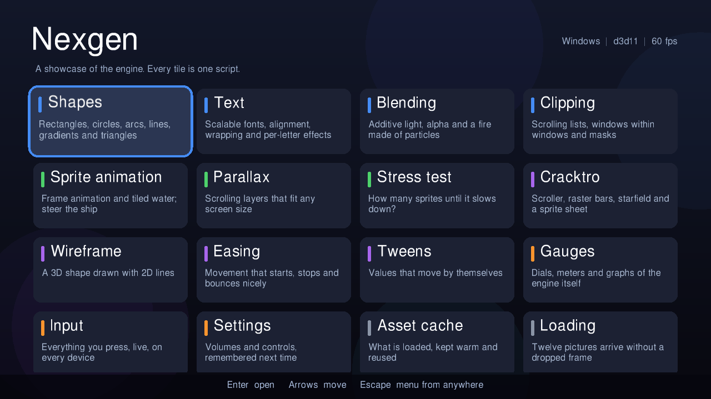
</p>

The same scripts run everywhere: all 25 demos keep 60 frames a second on a 64 MB original Xbox (measured in xemu). The engine is self-contained: it needs
a compiler and the platform's SDK, downloads nothing, and uses no SDL or GLFW.

## Screenshots

<p align="center">
  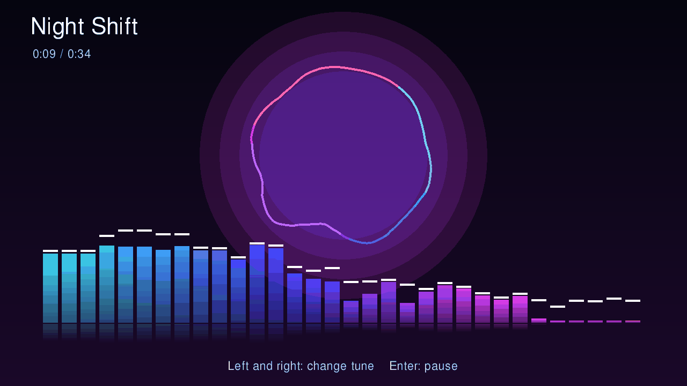
  
  
</p>
<p align="center">
  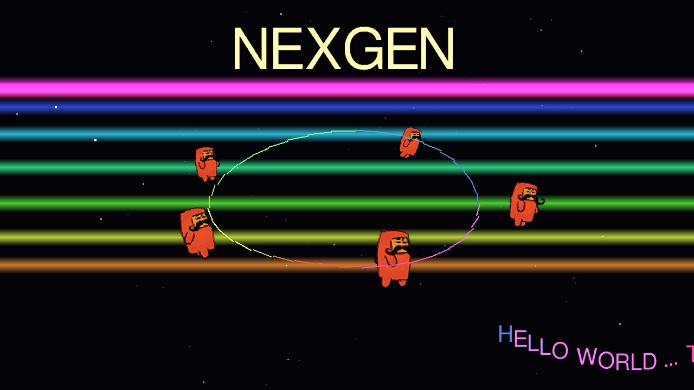
  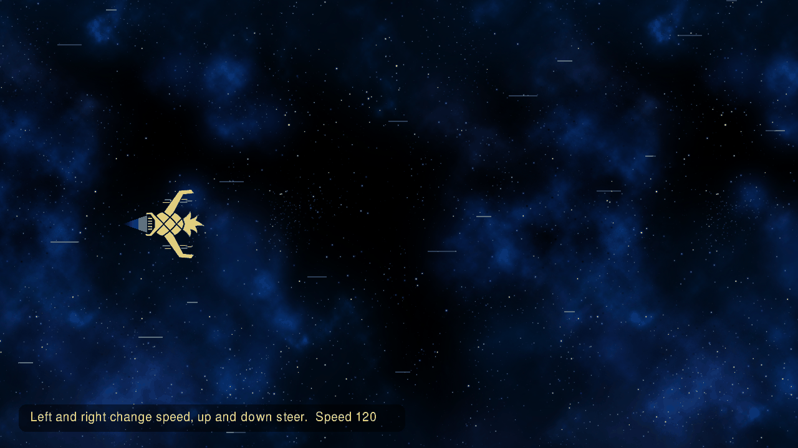
  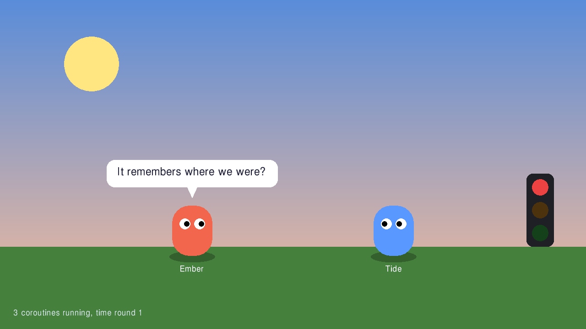
</p>
<p align="center">
  
  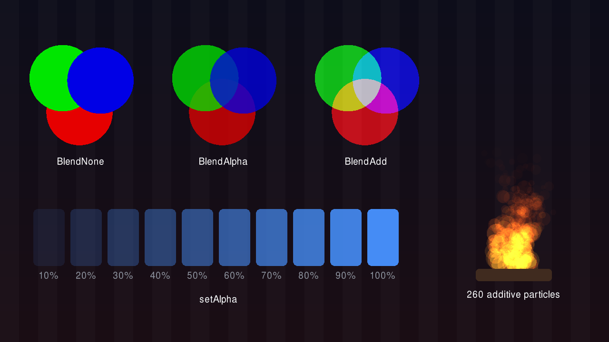
  
</p>
<p align="center">
  
  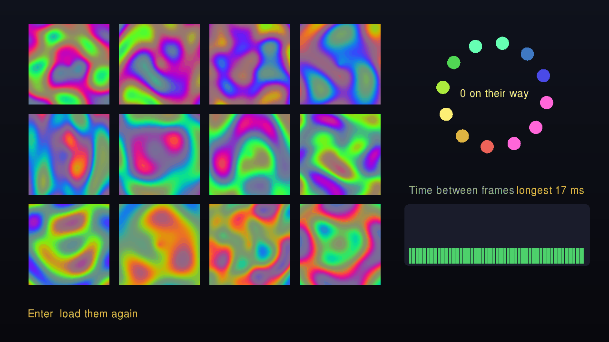
  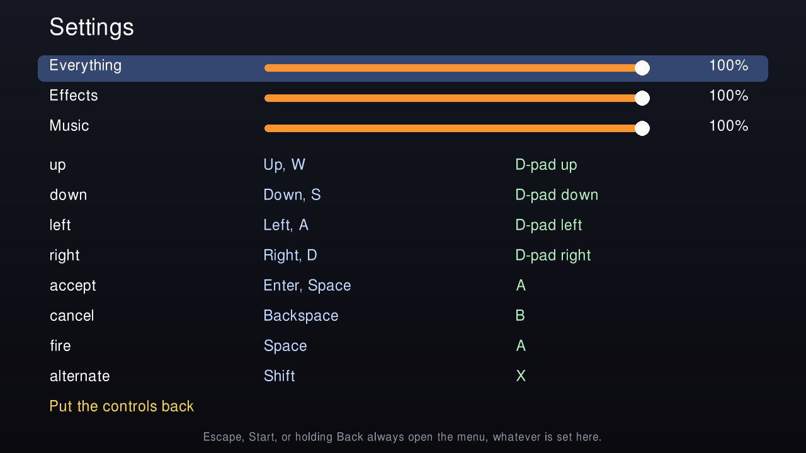
</p>
<p align="center">
  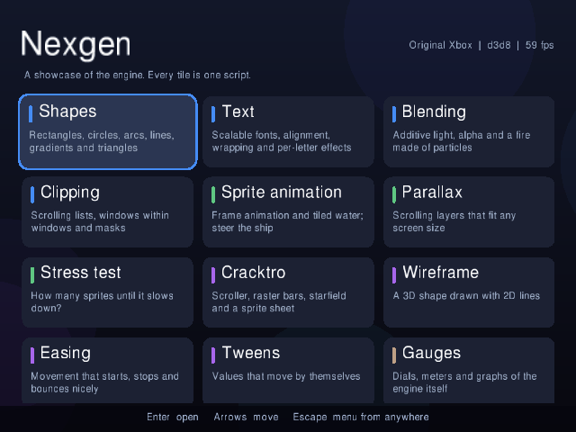
  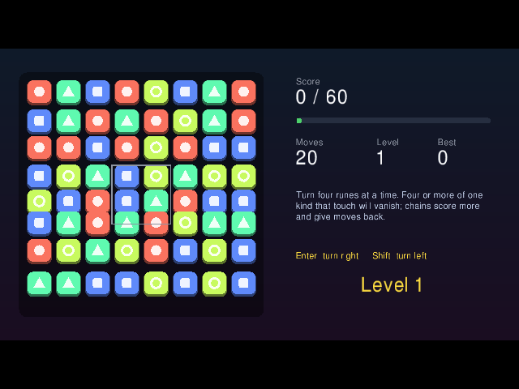
  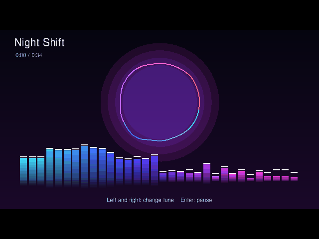
</p>
<p align="center"><sub>The last row is the original Xbox, in xemu</sub></p>

## Features

- **Scripts** — AngelScript 2.39.0. Each screen is one folder with one script; a mistake in it shows its file and line, and
  never takes the app down. Coroutines, tweens, and live reload while you edit.
- **2D drawing** — shapes, images, sprite sheets, nine-slice, tiling, scalable text, clipping and blending, batched, on any
  shape of screen.
- **Sound** — 32 voices with volume, pan, pitch and fades; WAV, Ogg Vorbis and MP3; spectrum and waveform for visualisers.
- **Assets** — loaded in the background, shared, kept warm and unloaded only when a budget needs the room.
- **Input** — keyboard, mouse and four gamepads as actions that players can rebind.
- **Saving** — settings and scores, kept between runs.
- **Cook tool** — turns images into compressed textures and sounds into ADPCM for the console, under the same names.

## Platforms

| Platform | State | Graphics | Sound |
|---|---|---|---|
| Windows 10 and 11 | Working | Direct3D 11 | miniaudio |
| Original Xbox | Working in xemu (64 and 128 MB); not yet tried on a console | Direct3D 8 | DirectSound |
| Linux | Working (X11) | OpenGL 3.3 | miniaudio |
| macOS 11 and later | Written, not yet tested | OpenGL 3.3 | miniaudio |
| Xbox 360, Xbox One and Series | Shared code compiles; to come | | |

## Download

Every run of the [Engine workflow](https://github.com/Team-Resurgent/NexgenRedux/actions/workflows/engine.yml) keeps a package
for each platform, with all the demo scripts in it:

| Package | What to do |
|---|---|
| `Nexgen-showcase-windows-x64` | Unzip and run `showcase.exe` |
| `Nexgen-showcase-linux-x64` | Unpack and run `./showcase` |
| `Nexgen-showcase-macos-arm64`, `-macos-x64` | Unzip and open the app. It isn't notarised: the first time, right-click it and choose Open |
| `Nexgen-showcase-xbox-og` | Copy the folder to the console, or run the `.iso` in xemu or from an ODE |

To change a demo, edit its `main.as` in `media/showcase` (inside the app on macOS, under `Contents/Resources`). Started with
`--dev`, the showcase reloads scripts and images as they are saved.

## A screen

```cpp
class Hello : Screen
{
    Font@ font = assets::font("global:freesans.sfn", 48);
    Sound@ pop = assets::sound("global:sound/pop.wav");
    Tween size(0, 1, 0.6f, EaseOvershoot);

    void update(float dt)
    {
        if (input::pressed("accept")) pop.play();
    }

    void draw(Canvas@ c)
    {
        c.design(1280, 720);
        c.circle(640, 360, 200 * size.value, Blue);
        c.text(font, "Hello", 640, 330, White, AlignCenter);
    }
}
```

Put that in `media/showcase/hello/main.as` beside a `screen.json` with a title, and it appears in the menu. Everything that
scripts can call is in [docs/ScriptReference.md](docs/ScriptReference.md), which the engine writes itself.

## Building

See [engine/README.md](engine/README.md). In short, from `engine/`:

```powershell
cmake --preset windows
cmake --build --preset windows
ctest --preset windows
```

```powershell
cmake --preset xboxog-release
cmake --build --preset xboxog-release
```

The Xbox build needs [RXDK](https://github.com/Team-Resurgent/RXDK-VSCode).

## What is where

| Folder | What it is |
|---|---|
| `engine/` | The new engine, described above |
| `docs/` | [The plan](docs/EnginePlan.md) and [the script reference](docs/ScriptReference.md) |
| `NexgenRedux-Shared`, `-PC`, `-OG`, `-360`, `-UWP` | The first engine, kept as it is |
| `NexgenRedux-Docs` | The first engine's [script reference](https://team-resurgent.github.io/NexgenRedux-Docs/) (submodule) |
| `NexgenRedux-Media` | An example game for the first engine (submodule) |

To get the submodules as well:

```bash
git clone --recurse-submodules https://github.com/Team-Resurgent/NexgenRedux.git
```

## Credits

Nexgen Redux is by Team Resurgent: EqUiNoX, HoRnEyDvL and RetroMura.

The engine includes unmodified copies of [AngelScript](https://www.angelcode.com/angelscript/),
[SSFN](https://gitlab.com/bztsrc/scalable-font2), [stb](https://github.com/nothings/stb),
[miniaudio](https://miniaud.io) and [dr_libs](https://github.com/mackron/dr_libs), under their own licences in
`engine/third_party`.
