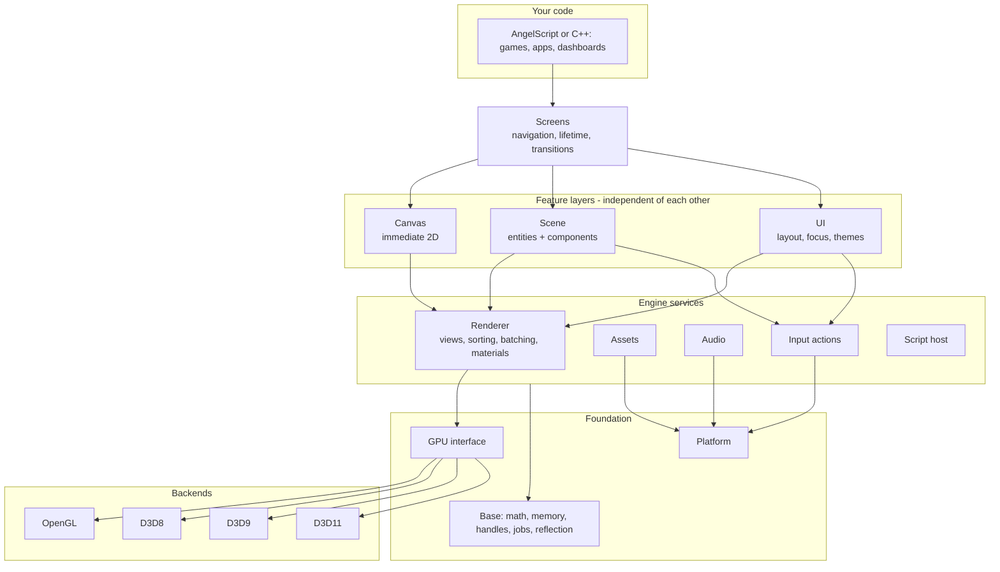
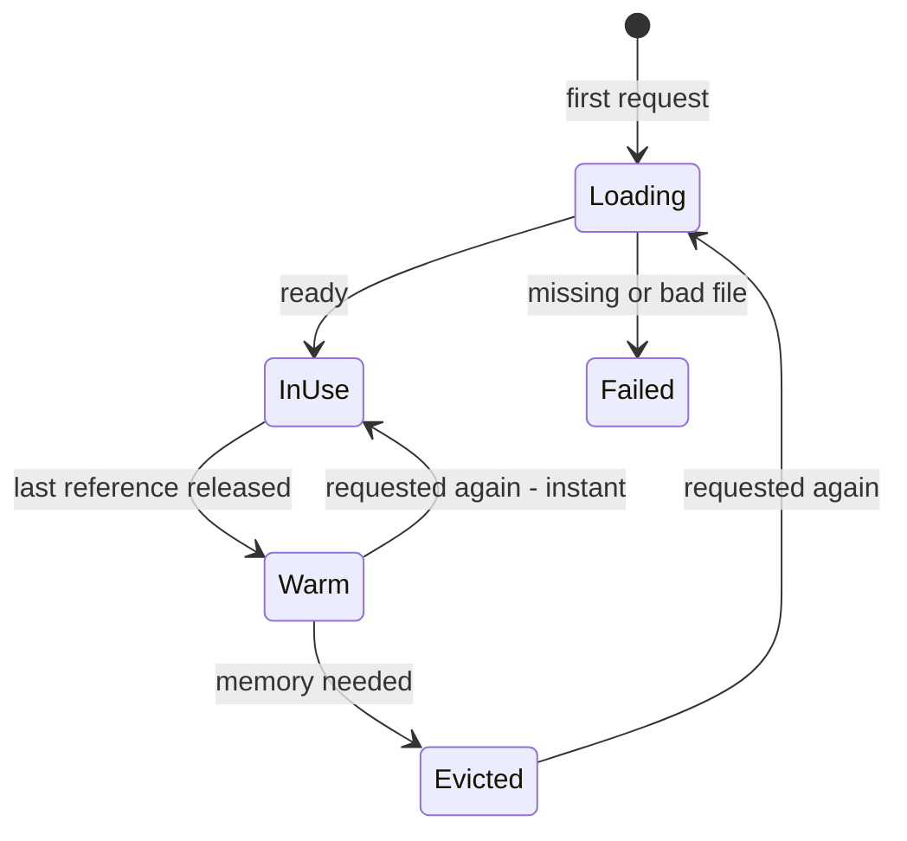

# Nexgen engine: review and redesign plan

Based on NexgenRedux at `1c21c5f`, the Shooter in `NexgenRedux-Media`, the Lua skins in
`Nexgen-Public`, the generated API page in `NexgenRedux-Docs`, and the local RXDK repositories.

Contents: [1. Verdict](#1-verdict) · [2. Review](#2-review-of-the-current-engine) ·
[3. What you were aiming for](#3-what-you-were-aiming-for) · [4. Decisions](#4-key-decisions) ·
[5. Architecture](#5-architecture) · [6. Layers in detail](#6-layers-in-detail) ·
[7. Keep, rework, replace](#7-keep-rework-replace) · [8. Roadmap](#8-roadmap) ·
[9. Risks](#9-risks) · [10. Decisions](#10-decisions)

---

## 1. Verdict

Build a new core and move the good parts across. Don't refactor the current one.

The problem isn't the ECS, because **there is no ECS**. `EntityEngine` is an inheritance scene graph
(`Node` → `Sprite`, `Text`, `OrthoCamera`...) with IDs looked up in a map. Each node also draws itself by
changing global render state. That one choice is why 2D, 3D, games and UI all have to fit through the same
narrow opening.

Your two engines each solved half the problem:

| | Nexgen (Lua) | NexgenRedux (AngelScript) | New engine |
|---|---|---|---|
| Style | Immediate: you draw everything | Retained: you set properties on fixed node types | Both, over one renderer |
| Flexibility | High: custom meshes, any draw order | Low: 6 node types, no custom drawing | High |
| Structure | None: about 20 lines of setup per frame | Some, but rigid | Entities + components |
| 3D | Mesh loading and lights | Camera and lights, **no mesh node** | Full |
| UI | None, hand drawn | None | Real UI system |

The fix is **layers that each work alone**: an immediate canvas, a composable scene and a UI tree. None of them
depends on another, and all of them feed the same renderer.

---

## 2. Review of the current engine

Marked **[ran]** where I built or ran it in a scratch copy, and **[read]** where it is from reading the code.

### 2.1 The PC build is broken at HEAD

| # | Problem | Where | |
|---|---|---|---|
| 1 | Doesn't compile on Windows: `m_initialized` is only declared for OG/360 but used everywhere | [DriveManager.cpp:87](../Libraries/Gensys/DriveManager.cpp#L87) | **[ran]** |
| 2 | Doesn't link: `PreLoader.cpp` is missing from `CMakeLists.txt` | [CMakeLists.txt](../CMakeLists.txt) | **[ran]** |
| 3 | With 1 and 2 patched, the Default skin exits at once with no window. Only the OG `main` calls `OnWindowCreate` | [NexgenRedux-PC/main.cpp](../NexgenRedux-PC/main.cpp) | **[ran]** |
| 4 | Shooter fails to compile: it passes 3 arguments to `WindowCreateWithSize`, which now takes 2. MemTest makes the same call | [Shooter/main.as:715](../NexgenRedux-Shared/Media/Shooter/main.as#L715) | **[ran]** Shooter, **[read]** MemTest |
| 5 | Can't build on Linux/macOS: the texture loader uses Win32 `HANDLE`/`CreateThread` with no guard | [TextureManager.cpp:28](../NexgenRedux-Shared/TextureManager.cpp#L28) | **[read]** |
| 6 | The 360 and UWP projects reference files that no longer exist (`BootLoader.cpp`, `JoystickManager.cpp`) | `NexgenRedux-360`, `NexgenRedux-UWP` | **[read]** |

So today only the OG Xbox target can be working. Four hand-kept source lists (CMake, vcproj and two vcxproj) is the root cause.

### 2.2 Scene graph bugs

| # | Problem | Where | |
|---|---|---|---|
| 7 | **Deleting a node that has children crashes.** Parents normally have lower IDs, so they are freed first and the child then dereferences a null parent | [NodeManager.cpp:169](../NexgenRedux-Shared/EntityEngine/NodeManager.cpp#L169) | **[ran]** segfault |
| 8 | **Moving a parent doesn't move its children.** The dirty flag is never passed down. Test: parent moved to x=100, child stayed at 0 | [Node.cpp:160](../NexgenRedux-Shared/EntityEngine/Node.cpp#L160) | **[ran]** |
| 9 | Scripts hold raw pointers (`asOBJ_NOCOUNT`), so a deleted node leaves them dangling | [AngelScriptRunner.cpp:764](../NexgenRedux-Shared/AngelScriptRunner.cpp#L764) | **[read]** |
| 10 | Fog, lights and cameras affect nodes by draw order, so structure becomes a chain (camera → fog → lighting → everything) | Shooter `Init()` | **[read]** |

### 2.3 Renderer

| # | Problem | Where | |
|---|---|---|---|
| 11 | **State changes get lost.** Setting a new value twice before a draw clears the dirty flag, so the GPU never sees it | [RenderStateManager.cpp:327](../NexgenRedux-Shared/RenderStateManager.cpp#L327) and every other setter | **[ran]** |
| 12 | No batching: one draw call and one buffer upload per sprite. `CanBatch()` is never called, and every sprite changes the model matrix anyway | [RenderStateManager.cpp](../NexgenRedux-Shared/RenderStateManager.cpp) | **[read]** |
| 13 | Every uniform set does two string-map lookups, copying both strings | [OpenGLRenderingHelper.cpp:1188](../NexgenRedux-Shared/OpenGLRenderingHelper.cpp#L1188) | **[read]** |
| 14 | Specular for all four lights uses light 1's colour | [OpenGLRenderingHelper.cpp:211](../NexgenRedux-Shared/OpenGLRenderingHelper.cpp#L211), 228, 245, 262 | **[read]** |
| 15 | OG: async textures set max UV to 1, while the sync path scales it for power-of-two padding. Padded images will draw wrongly | [XboxOGRenderingHelper.cpp:1175](../NexgenRedux-Shared/XboxOGRenderingHelper.cpp#L1175) vs 1050 | **[read]** |
| 16 | OG: line lists draw `vertexCount / 3` primitives; it should be `/ 2` | [XboxOGRenderingHelper.cpp:1236](../NexgenRedux-Shared/XboxOGRenderingHelper.cpp#L1236) | **[read]** |
| 17 | Lights are four copies of the same fields and functions in every layer; vertices have no colour | `IRenderingHelper.h`, `MeshUtility.h` | **[read]** |

### 2.4 Text, textures, audio, timing

| # | Problem | Where | |
|---|---|---|---|
| 18 | Text textures are keyed by the **string only**. Two labels saying "OK" in different sizes share one texture, and reloading it leaks the first | [Text.cpp:54](../NexgenRedux-Shared/EntityEngine/Text.cpp#L54) | **[read]** |
| 19 | Any text change re-rasterises and uploads a whole texture (an FPS counter does this constantly) | `Text::Update` | **[read]** |
| 20 | Texture queue race: `Request` adds without the lock while the worker keeps a pointer into the same vector | [TextureManager.cpp:59](../NexgenRedux-Shared/TextureManager.cpp#L59), 95 | **[read]** |
| 21 | Audio race: the audio thread walks a `std::map` that the main thread inserts into and erases from | [AudioManager.cpp:91](../NexgenRedux-Shared/AudioManager.cpp#L91), 177, 209 | **[read]** |
| 22 | Audio only has `PlayAudio`: the Lua engine's stop, volume and is-playing were lost | `AudioManager.h` | **[read]** |
| 23 | Timing uses `clock()` at 1 ms resolution, so `dt` is coarse and is sometimes 0 | [TimeUtility.cpp:36](../Libraries/Gensys/TimeUtility.cpp#L36) | **[read]** |

### 2.5 Script API and documentation

| # | Problem | Where | |
|---|---|---|---|
| 24 | **`==` doesn't work on any vector, colour, size or rect in scripts.** They register `opEq`/`opNotEq`, but AngelScript's name is `opEquals` | [AngelScriptRunner.cpp](../NexgenRedux-Shared/AngelScriptRunner.cpp), 20 registrations | **[ran]** Vec2F fails to compile |
| 25 | **No vector × number.** `a * 2.0f` fails; only vector × vector exists | same | **[ran]** |
| 26 | The docs describe nothing: every function is a bare signature. Only 8 types have a one-line description | `NexgenRedux-Docs/index.html` | **[read]** |
| 27 | No enum values (13 enums, 54 values), callback signatures or entry points (`Init`, `Update`, `OnWindowCreate`), so you can't write a first script from the docs | same | **[read]** |
| 28 | Last generated 2023-04-06. Perspective camera, audio, preloader and `WindowSetTitle` are missing, and window creation is out of date, which is the change that broke Shooter (4) | same | **[read]** |
| 29 | The page is regenerated on every Windows launch, inside the shipped app | [AngelScriptRunner.cpp:1034](../NexgenRedux-Shared/AngelScriptRunner.cpp#L1034) | **[ran]** |
| 30 | The older engine was better here: 118 documented functions, with parameters and return values | `Nexgen-Public/Media/global/*.lua` | **[read]** |

### 2.6 Memory and reloading

| # | Problem | Where | |
|---|---|---|---|
| 31 | **Textures are freed as soon as nothing uses them**, every frame. When the last bullet dies its image is deleted; the next shot loads it from disk again. `PreLoader` exists to work around this | [WindowManager.cpp:167](../NexgenRedux-Shared/WindowManager.cpp#L167) | **[read]** |
| 32 | The loader sleeps 100 ms between textures, so about 10 per second at best | [TextureManager.cpp](../NexgenRedux-Shared/TextureManager.cpp) `ProcessThread` | **[read]** |
| 33 | **Every sound play opens the file again** and creates a new decoder, on the main thread. Ten gunshots are ten opens | [AudioManager.cpp:194](../NexgenRedux-Shared/AudioManager.cpp#L194) | **[read]** |
| 34 | Every sprite is a separate heap object with its own vertex array, and bullets are created and deleted constantly | [NodeManager.cpp:69](../NexgenRedux-Shared/EntityEngine/NodeManager.cpp#L69) | **[read]** |
| 35 | Finding a texture walks the whole list comparing paths, and `Skin:A.png` and `skin:a.png` are two copies | [OpenGLRenderingHelper.cpp:891](../NexgenRedux-Shared/OpenGLRenderingHelper.cpp#L891) | **[read]** |
| 36 | No budgets, no tracking and no idea what is using memory | everywhere | **[read]** |

### 2.7 What is good and worth keeping

- AngelScript with your debugger. It is a strong choice: typed, fast, easy to embed, proven here on OG with the old XDK.
- Virtual paths (`skin:`, `asset:`, `global:`) and the skin folder idea.
- Gensys: files, drives, FTP, sockets, logging. This is real Xbox knowledge.
- The OG know-how: swizzling, keyboard/mouse, DirectSound streaming.
- Generating docs from the bindings, and the Lua engine's habit of describing parameters and returns.
- API worth carrying over: text measuring, hit testing, random, clipboard, multiple monitors, memory queries, the full math list.
- The sample games, which become scenes in the showcase.

---

## 3. What you were aiming for

Each sample needs something the engine has to make easy:

| Sample | Needs |
|---|---|
| `cracktro` | Immediate drawing, per-letter animated text, sprite sheets, custom line meshes |
| `Animation Sample` | Frame animation, held-button input |
| `Parallax Horizontal 2` | Scrolling layers. Loads the same files three times in a branch per resolution, so it needs **resolution independence** |
| `Pong`, `Tetris` | Game states, timers, text, sound, AI |
| `Shooter` (Redux) | Spawn/despawn, collision, pooling, preloading, fades |
| `sysinfo`, FTP, HTTP, drives | **Dashboard UI**: menus, lists, focus, gamepad navigation |

The Shooter shows the cost of missing features best. About 1,030 lines, including hand-written fade timing,
bullet timing, AABB collision, parallax wrap and input polling. Those should be engine features.

---

## 4. Key decisions

### 4.1 Use modern C++ everywhere

The old code was held to C++98 by VS2003. That limit is gone: RXDK is clang with libc++ (C++23) for OG Xbox, and
RXDK-360 has a clang toolset. OG also has a **CMake toolchain file**.

**Decision:** C++20, no exceptions or RTTI in engine code, one CMake build, and drop the VS2003 project.

### 4.2 One platform layer, several GPU backends

| Target | Platform | GPU backend | Tier |
|---|---|---|---|
| Windows | Win32 | Direct3D 11 | Modern |
| Linux | X11 | OpenGL 3.3 | Modern |
| macOS | Cocoa | OpenGL 3.3 (Metal later if Apple drops it) | Modern |
| Original Xbox | RXDK XAPI | Direct3D 8 | Fixed |
| Xbox 360 | Native | Direct3D 9 (XDK) | Shader |
| Xbox One / Series (UWP) | Native | Direct3D 11 | Modern |

**No SDL.** Each platform layer is small (about 200 lines so far), and the engine only depends on its own interfaces.
Direct3D 11 also covers Xbox One / Series, so that target shares its GPU backend with Windows. Audio goes straight to
WASAPI, DirectSound (OG), XAudio2 (360, Xbox One), ALSA and Core Audio, with one mixer of our own above them.

**All platforms stay in.** They differ in when they are tested:

| Group | Targets | Rule |
|---|---|---|
| Active | Windows, OG Xbox | Run and tested in every phase |
| Desktop | Linux, macOS | Platform layer in phase 1, built in CI from phase 2, run at the end of each phase |
| Later | Xbox 360, Xbox One / Series | Designed for from day one, tested on hardware in phase 6 |

To stop the *Later* group from rotting, as it did in the current repo:

- They are targets in the same CMake project, never separate hand-kept projects.
- Linux and macOS have no platform layer until phase 1; until then they have not been built.
- Phase 0 compiles the base layer for both, where the toolchain allows it. After that, the shared layers are compiled
  for them each phase, with the null GPU backend until theirs exists.
- Big-endian (360), small memory and fixed-function limits are rules for shared code now. File formats are read
  through endian-safe helpers, and a unit test covers byte order on PC.

### 4.3 Entities + components, but only for the scene

Use a small **sparse-set** component store: simple, low memory, fast to add and remove, and suitable for a 64 MB
console. Write it (around 500 lines) rather than adopt EnTT, because scripts need to define component types at run time.

Do **not** put UI or immediate drawing in the ECS. UI is a tree with layout, focus and ordering, and an ECS makes
that painful. This is the usual reason people end up unhappy with a home-made one.

Nobody needs to think in ECS terms to use it. Scripts see friendly objects: `e.position`, `e.add(Sprite)`.

### 4.4 Rendering is data, not state

Nothing "sets the blend mode". Code submits **draw items** to a **view**; the renderer sorts, batches and issues
them. This removes bugs 10–13 as a class, and gives multiple cameras, split screen, render targets and
"3D model inside a UI panel" for free.

### 4.5 One material works at every tier

A material is described by what it looks like (texture, colour, blend, lit, fog). Each backend maps that to
combiners on OG or shaders elsewhere. Custom shaders are optional per tier, with the standard material as fallback.

### 4.6 AngelScript only, with generated bindings

AngelScript is the one scripting language. No Lua: the old skins are rewritten as showcase scenes.
C++ can implement the same interfaces where speed matters.

Today there are over 550 registration lines, with transform functions repeated per node type.
Instead, describe each type **once**; that one description drives script binding, save/load, the inspector, docs and editor completion.
A binding with no description fails the build.

**Update AngelScript from 2.36.0 to 2.39.0**, in phase 0, before the RXDK test. The copy in `Libraries` is from 2022;
2.39.0 came out on 2026-11-09 ([change log](https://www.angelcode.com/angelscript/changes.php)).

| | |
|---|---|
| Worth having | `foreach`, `using namespace`, template functions, deletable/auto copy constructors, enum underlying types, a newer JIT interface, many fixes |
| Helps our targets | Assembly ported for pure clang on Windows; core builds as C++98 again. The log lists no Xbox or 360 removals, and no PowerPC changes |
| Needs care in C++ | `RegisterObjectType` flags are now 64-bit; line and exception callbacks are passed differently (the debugger sets a line callback) |
| Needs care in scripts | Default copy operations are generated, objects can convert to bool in conditions, explicit copy constructors are no longer used implicitly. Engine properties can restore most old behaviour |
| Debugger | 2.39 removes the first suspend point in each function, so re-test stepping and breakpoints |
| Saved bytecode | Treat as incompatible across versions: always rebuild it with the engine |

Our own edits since the first import are only a few lines in three files (`scriptbuilder.cpp`, `as_callfunc_xenon.cpp`,
`as_context.cpp`). Keep a clean upstream copy pinned to one version, with those as separate patches, so the next update
is easy. Update the add-ons with it. Since 2.39.0 is only weeks old, 2.38.0 is the fallback if it misbehaves.

### 4.7 The first release is a showcase

One app with a main scene that lists sub-scenes. Pick one, try it, go back, pick another.
It is a demo, the test suite and a template for a dashboard all at once. See section 6.1.

### 4.8 Load once, keep warm, free late

Releasing an asset doesn't unload it. It moves to a **warm cache**, and is only freed when memory is needed for
something else. Allocation in the frame loop comes from pools and arenas rather than the heap. See section 6.7.

### 4.9 Self-contained

The engine needs a compiler and the platform's SDK. Nothing is downloaded, installed or linked from elsewhere, and a
test (`self_contained`) fails the build if that changes.

**Frameworks are out** (SDL, GLFW, GLAD, ANGLE): windows, input, files, threads and GL loading use system APIs directly.

**Small source libraries are in**, at their latest version, each an unmodified copy in `third_party` with its version noted:

| Library | For | Added in |
|---|---|---|
| AngelScript | Scripting | phase 0 |
| stb_image | Images | phase 1 |
| SSFN | Scalable fonts | phase 1 |
| stb (dxt, vorbis), miniaudio with dr_libs, miniz | Texture compression, audio, pak files | phase 2 |
| cgltf | 3D models | phase 5 |

- **Consoles load cooked data** from phase 2, so most of these then run only in the cook tool. Music is cooked to ADPCM,
  which the OG Xbox plays in hardware.
- miniaudio covers desktop output and mixing. OG keeps DirectSound, and 360 and Xbox One use XAudio2.
- They read untrusted files, so loading is fuzzed and limits are checked before anything is allocated.

---

## 5. Architecture



Rules that keep it flexible:

1. **Arrows only point down.** Canvas, Scene and UI never include each other. CMake targets enforce it.
2. **Each layer is optional.** A dashboard can ship with no Scene, a game with no UI.
3. **No singletons.** One `Engine` object owns the services and passes them in.
4. **Handles, not pointers.** Textures, entities and sounds are index + generation, so a stale one is detected rather than crashing (fixes 9).
5. **Platform `#if`s live only in `platform/` and `gpu/`.**
6. **A screen can use any mix of layers**, and owns everything it creates.
7. **New features are modules** (`init`, `update`, `render`, `shutdown`): physics, particles, video and networking plug in this way.

### Repository layout

```
engine/
  base/       math, containers, memory, handles, jobs, log, reflection
  platform/   win32/  xboxog/  xbox360/  uwp/  x11/  cocoa/
  gpu/        interface + d3d11/  d3d8/  d3d9/  gl/  null/
  render/     views, batching, materials, text, lighting
  screens/  canvas/  scene/  ui/
  assets/  audio/  input/  script/
modules/      physics2d/  particles/  video/  net/  dashboard/   (Gensys: FTP, drives)
tools/        cook/  inspector/
showcase/     main/  cracktro/  animation/  parallax/  shooter/  ui/  dashboard/  scene3d/  ...
tests/
legacy/       the current engine, until parity
```

`gpu/null` draws nothing, so scene, UI and script logic can be tested on any build machine.

### Frame

```
poll input → run fixed steps (60 Hz): scripts, physics, animation
           → variable update: UI, tweens, camera
           → transforms (parents before children)
           → collect views → sort/batch → draw → present
           → recycle destroyed objects, trim the cache if over budget, reset the frame arena
```

Fixed steps with a high-resolution clock fix 23, and make OG and PC play the same.

---

## 6. Layers in detail

Script examples are the **target API**: proposed, not existing.

### 6.1 Screens and the showcase

A **screen** is anything you can go to: the main menu, a game, a UI page, a 3D scene. Screens live on a stack.

```angelscript
class MainScreen : Screen {
    void onEnter() {
        ui.show(Grid(columns: 3, gap: 16, {
            Tile("Cracktro", "Canvas, text effects").onSelect(function() { screens.push("showcase:cracktro"); }),
            Tile("Shooter",  "2D game").onSelect(function()              { screens.push("showcase:shooter"); }),
            Tile("3D Scene", "Meshes, lights").onSelect(function()       { screens.push("showcase:scene3d"); })
        }));
    }
}
```

In the real showcase the tiles are built from the folders found, so **adding a scene means adding a folder**:

```
showcase/shooter/
  screen.json     title, description, thumbnail, tags, minimum tier, memory budget
  main.as         its Screen class
  asset/  audio/
```

| Call | What happens |
|---|---|
| `screens.push(id)` | Current screen is suspended, the new one loads and opens on top |
| `screens.pop()` | Closes this one and returns to the screen below, with its focus and scroll position intact |
| `screens.replace(id)` | Swaps the current one (title → game → results) |
| `screens.home()` | Unwinds all the way to the main scene |
| `screens.overlay(id)` | Opens over a paused but still visible screen (pause menu, dialog) |

Lifecycle: `onLoad` (async, behind a loading view) → `onEnter` → `update` / `draw` → `onSuspend` / `onResume` → `onExit`.

**Returning to main must always work:**

- **The engine owns "back".** Escape, or *holding* Back on a pad, opens an overlay: Resume / Restart / Main menu.
  A screen can handle a short press itself but can't block the hold.
- **Each screen is isolated.** It has its own script module, asset group, entity world, UI tree, audio voices and
  input context. Closing it destroys its objects and releases its assets, whatever the script forgot. Released assets
  stay warm in the cache, so reopening is quick (6.7).
- **A script error doesn't end the app.** It stops that screen and shows the message and line, with Retry / Main menu.
  An endless loop is caught by a time limit.
- **Suspended screens cost little.** They don't update or draw, and their sounds pause. Their assets count as warm, so
  they are dropped only if the next screen really needs the memory.
- **Screens return results**, e.g. a file picker: `screens.push("files", function(result) { ... })`.

**Test for every scene:** open and close it 100 times. The second open must load nothing from disk if it fits the budget;
memory must stop growing; and after `assets.trim()` it must be back at the starting point.
It runs on the null GPU in CI and on OG Xbox by hand. This is also how a dashboard launches skins.

#### What the showcase contains

The more scenes the better: each feature gets one, and each is a single script that doubles as an example.

| Scene | Shows | Phase |
|---|---|---|
| Main menu | Navigation, mouse, fitting any screen shape | 1, rebuilt on UI in 4 |
| Shapes, Text, Blending, Clipping | Everything the canvas draws | **1 done** |
| Sprite animation, Parallax, Stress test | Sheets, tiling, batching | **1 done** |
| Cracktro, Wireframe, Easing | Effects, projection, movement | **1 done** |
| Gauges, Input | Live engine numbers, every device | **1 done** |
| Asset cache, Broken script | Sharing and warm assets; errors that stop one screen only | **1 done** |
| Sky Patrol | A small complete game | **1 done** |
| Paddle game, Block puzzle | Game states, AI, grids (original rules and art) | 2 |
| Audio, Music visualiser, Tweens, Coroutines, Hot reload | Sound, timing, live editing | 2 |
| Memory | Budgets per system, evictions, leaks | 2 |
| Shooter, Platformer, Physics toys, Tile map, Particles editor | Entities, prefabs, collision, pooling | 3 |
| UI gallery, Forms, Long list, Themes, Dashboard, File browser | Widgets, layout, focus, system info | 4 |
| 3D model viewer, Lights, Materials, Skinning, Terrain with LOD | Meshes and the renderer's tiers | 5 |
| Ray-marched scenes, Clouds and fog, Reflections, Particles in 3D | Shader effects, with a lower-tier version for each | 5 |
| Split screen, 3D in a UI panel, Crowd stress test | Several views at once, instancing | 5 |

### 6.2 Canvas: immediate 2D

The freedom the old engine had, without the matrix setup.

```angelscript
void onDraw(Canvas@ c) {
    c.design(1280, 720, Fit);                 // resolution independent
    c.image(background, 0, 0);
    c.push();
        c.translate(400, 300); c.rotate(time * 20); c.scale(6);
        c.sprite(sheet, frame);
    c.pop();
    for (uint i = 0; i < msg.length(); i++)
        c.text(font, msg.substr(i, 1), x + i * 20, 450 + sin(time + i * 0.1f) * 100, Green);
    c.circle(100, 100, 25, stroke: White);
}
```

- Images, sprite sheets, nine-patch, tiled images, lines, shapes, paths, text, clipping, blend modes, layers, render targets.
- Transforms and colours go into the vertices on the CPU, so a run of sprites on one atlas is **one draw call**.
- `design()` replaces the "three branches for three resolutions" in Parallax 2.
- `c.mesh(...)` for custom geometry.

### 6.3 Scene: entities and components

```angelscript
Entity@ ship = scene.spawn("ship");
ship.position = Vec3(640, 60, 0);
ship.add(Sprite("asset:images/ship.png"));
ship.add(Collider(Box(64, 64), layer: Player));
ship.add(PlayerController());

class PlayerController : Behaviour {
    float speed = 300;
    void update(float dt) {
        entity.position += input.axis2("move") * speed * dt;
        if (input.pressed("fire")) scene.spawn("prefab:bullet", entity.position);
    }
    void onHit(Entity@ other) { other.destroy(); }
}
```

- Storage: one packed array per component type. Systems walk the arrays; there are no virtual calls per entity.
- Hierarchy: entities ordered by depth, so one pass updates parents before children (fixes 8). Destroy is recursive and deferred (fixes 7).
- Built-in components: transform, sprite, animation, text, mesh, skinned mesh, light, camera, collider, particles, audio source, behaviour.
- **Cameras and lights are ordinary components.** A light affects what is in range, not whatever is drawn after it (fixes 10).
- 2D and 3D share one transform and one scene. Depth is sorted by layer for 2D and by the depth buffer for 3D.
- Prefabs and scenes are text files, cooked to binary for consoles.
- Each screen has its own entity world, so a game and its pause menu never mix.

### 6.4 UI

Its own retained tree.

```angelscript
ui.show(Column(gap: 12, padding: 24, {
    Label("Games").style("title"),
    List(games).row(function(g) { return GameTile(g); }).onSelect(@launch),
    Row({ Button("Settings").onClick(@openSettings), Button("Files").onClick(@openFiles) })
}));
```

- Flex-style layout: row, column, grid, stack, scroll. Virtualised lists (a 500-game list builds only visible rows).
- **Gamepad first:** automatic d-pad focus navigation, plus mouse, touch and keyboard through the same events.
- Themes and style states (normal, focused, pressed, disabled), transitions, TV safe area, on-screen keyboard, localisation.
- Custom widgets get a `Canvas` to draw with. A `SceneView` widget hosts a 3D or 2D scene inside the UI.
- Optional layout files for skins that designers can edit without code. Code and files build the same tree.

### 6.5 Renderer and GPU

- **View** = camera + target + viewport + clear + layers.
- **Draw item** = 64-bit sort key + pipeline + material + geometry + transform. 2D keeps paint order; opaque 3D goes front to back; transparent 3D goes back to front.
- **GPU interface** is small: buffers, textures, immutable pipelines, render targets, draws. No state setters.

| | Fixed (OG) | Shader (360) | Modern |
|---|---|---|---|
| Standard material | Combiners, hardware T&L | SM3 shaders | Uber shader |
| Lights | Nearest 4 | Nearest 4–8 per pixel | Many, shadows |
| Skinning | Vertex shader 1.1, few bones per batch | Vertex shader | Vertex / compute |
| Text | Baked atlas | Baked or distance field | Distance field |
| Post effects | Minimal | Some | Full |

Tiers add quality. They never change what a script has to write.

**Level of detail.** The cook tool builds simpler versions of each mesh, and the renderer picks one by how big it will be on
screen, with a little hysteresis so it doesn't flicker:

| | Fixed (OG) | Shader (360) | Modern |
|---|---|---|---|
| Meshes | 3 to 4 levels, hard switch | Levels with a dithered fade | More levels, dithered fade |
| Far away | Flat impostor sprite | Impostor with lighting | Impostor with depth |
| Groups | Merged distant buildings (HLOD) | Same | Same, streamed |
| Terrain | Fixed grid of patches, stitched edges | Same | Continuous, morphing |
| Also reduced with distance | Bones, lights, particles, texture size, update rate | Same | Same |

Culling comes first: outside the view, behind portals or occluders, and too small to see.

**Ray marching** renders shapes defined by distance functions instead of meshes: smooth blends, endless repetition, soft shadows,
clouds, fog and water.

- **Modern:** full-screen or inside a box that depth-tests against ordinary meshes, at half resolution with upscaling when needed.
- **Shader (360):** small screens or boxes, few steps. **Fixed (OG):** no pixel shader long enough, so each effect names a
  stand-in: a mesh baked from the same distance function by the cook tool, a pre-rendered animation, or a low-resolution picture computed
  on the CPU.
- Scenes are described in script with a few shapes and operators (`sphere`, `box`, `smoothUnion`, `repeat`), from which the
  shader, the baked mesh and collision are all made. Custom shaders are still allowed.
- Each effect has a step budget, so a slow one drops quality rather than frames.

Other modern effects in the same phase: shadow maps, ambient occlusion, bloom and tone mapping, reflections, decals, GPU
particles and instancing. Each has a tier at which it starts and something cheaper, or nothing, below it.

**Text** uses glyph atlases: changing a string only rewrites quads (fixes 18, 19).

### 6.6 Assets

- Handle based, asynchronous and **cached** (6.7): `Texture@ t = assets.texture("asset:ship.png")` returns at once with a placeholder.
- A proper job queue with several requests in flight replaces the racy, sleeping one (fixes 20, 32). Groups replace `PreLoader`: `assets.group("level1").ready`.
- **Cook tool** per platform: DXT + swizzle on OG, big-endian on 360, BC7 on PC; glTF → runtime mesh (with cgltf); fonts → atlases; everything into one pak.
  This matters on OG: an uncompressed 1024×1024 image is 4 MB of 64 MB, and DXT1 is 0.5 MB.
- PC can load loose PNG/glTF, with hot reload of textures, layouts and scripts.

### 6.7 Memory and caching

#### Ideas borrowed

| From | Idea | How we use it |
|---|---|---|
| LÖVE | One `SoundData`, many cheap `Source` clones; *static* vs *stream* sources; `SpriteBatch` | Sound data is shared and voices are light; load modes; batching |
| Unity | Addressables reference counts, `ObjectPool`, audio load types, sprite atlases, temp/persistent allocators | Handles, pooled prefabs, three sound modes, cooked atlases, frame and screen arenas |
| XNA / MonoGame | A `ContentManager` per scope that unloads as a unit | Each screen owns an asset group |
| Godot | Loading the same path returns the same resource; threaded load requests | Canonical key, async jobs |
| Bevy | Strong and weak handles | Both supported |

What we avoid: Unity's and LÖVE's habit of leaving unused memory to a garbage collector or a manual
`UnloadUnusedAssets`, both of which can hitch. Ours is automatic, incremental and budgeted.

#### Life of an asset



- **One copy per asset.** The key is a cleaned-up path (case, slashes, aliases) plus import options. Asking twice returns the same data, even while the first load is still running. Lookup is a hash, not a search (fixes 35).
- **Warm, not freed.** Unreferenced assets stay loaded in a least-recently-used list (fixes 31).
- **Evict by value.** Old, large and quick-to-reload goes first. Something slow to load (DVD) or often reused is kept longer.
- **Two limits per type.** Above the *soft* limit, evict a little each frame. Reaching the *hard* limit evicts at once before the new load.
- **Never evict what is in use.** If everything is in use and the budget is full, the load fails with a clear message and a placeholder, and the log lists the biggest users.
- **Safe timing.** GPU memory is returned only after the GPU has finished with it, never mid-frame.
- **Failures are remembered**, so a missing file isn't tried again every frame.
- **Handles survive reloads.** Hot reload or a lost device swaps the data underneath.

#### Changing screens

1. Load the new screen's group **first**. Anything shared gains a second reference, so it is never dropped and reloaded.
2. Show the new screen.
3. Release the old group. Its assets go **warm**, so going back to the main menu is instant.
4. Evict only if over budget.

If both can't fit (OG), the order flips, but shared assets are still kept. `screen.json` can list `keep` (stay warm as
long as possible) and `preload` (start while the player is on the menu tile).

#### What is cached

| Thing | Cached as | Notes |
|---|---|---|
| Textures | GPU memory, atlased where possible | Cooked, so no decoding at run time |
| Sounds, short | Decoded or ADPCM in memory | Play = take a voice. **No file access** (fixes 33) |
| Sounds, medium | Compressed in memory | Decoded while playing |
| Music | Streamed, small ring buffer | First moments kept so it starts at once |
| Fonts / glyphs | Glyph atlas with its own LRU | Laid-out strings cached by text + font + width |
| Meshes, animations | GPU buffers | Shared by all instances |
| Materials, pipelines, shaders | By hash of their description | Built once; warmed during loading to avoid hitches |
| Render targets | Pool by size and format | Reused between effects and screens |
| Prefabs, UI layouts, scripts | Parsed or compiled form | Bytecode cached per engine version |
| File data | Pak read cache; on OG optionally a hard-disk copy of DVD data | Avoids repeated seeks |

**Voices:** a fixed pool (about 32, fewer on weak platforms). If it is full, the quietest or lowest-priority voice is
replaced, and each sound can set a maximum count, so fifty bullets don't make fifty sounds.

#### Allocators

| Allocator | For | Freed |
|---|---|---|
| **Frame arena** (double buffered) | Draw lists, sort keys, temporary strings, layout scratch | All at once, next frame |
| **Screen arena** | Things that live as long as a screen | All at once, on close |
| **Pools** | Entities, components, voices, UI nodes, particles | Slot goes back to the pool |
| **GPU heaps** | Textures, static buffers; ring buffers for dynamic vertices | By the cache; rings never |
| **General heap** (TLSF) | Everything else | Normally |

- Every allocation carries a **tag** (textures, audio, script, UI...), so each system has a budget and a live total (fixes 36).
- Containers take an allocator. `new`/`delete` are not used directly in engine code.
- Names and paths are **interned IDs**, not strings copied around.
- Debug builds add guard bytes and record the call site.

**Object pooling** is built into spawning (fixes 34):

```angelscript
scene.pool("prefab:bullet", 64);            // ready in advance
scene.spawn("prefab:bullet", pos);          // reuses a slot
bullet.destroy();                           // returns it; scripts get onSpawn / onDespawn
```

**AngelScript** allocates from its own pooled, tagged heap. Script objects that the engine owns are handles, which
avoids reference cycles. Garbage collection runs in small steps each frame, with a full pass only on screen changes.

#### Script API

```angelscript
Texture@ t = assets.texture("asset:ship.png");     // cached; loads once
Sound@ s = assets.sound("audio:shot.ogg");         // shared data
s.play(volume: 0.8f);                              // just a voice

AssetGroup@ level = assets.group("level1");        // replaces PreLoader
if (level.ready) start();

assets.pin(t);                                     // never evict
assets.trim();                                     // drop warm assets now
```

Scripts rarely need the last two. Dropping a handle is enough.

#### OG Xbox starting budget (goals, adjusted once measured)

| | MB |
|---|---|
| Kernel and framebuffers (480p) | 8 |
| Engine code and data | 8 |
| Textures | 22 |
| Audio | 6 |
| Meshes and animation | 6 |
| Scripts | 4 |
| UI and text | 3 |
| Scene and general | 4 |
| Reserve | 3 |
| **Total** | **64** |

720p needs several MB more for framebuffers, which comes out of textures. Larger platforms use the same categories
with bigger numbers, and a PC option **simulates the OG budget** so problems show up during development.

#### Seeing what is going on

- An on-screen overlay and the showcase's **Memory** scene: use per tag, in-use vs warm, hits, misses, evictions, biggest assets.
- **Thrash warning** when something is evicted and reloaded within a few seconds.
- **Leak report** when a screen closes: what is still held, and the script line that took it.
- A warning for any heap allocation inside the frame loop.

### 6.8 Audio, input, scripting

- **Audio:** voices by handle (play, stop, pause, volume, pan, loop, fade), buses (music, effects, UI), streamed music. The main thread sends commands through a lock-free queue (fixes 21, 22).
- **Input:** named **actions** (`"fire"` = A, Space, left mouse) plus raw devices. Pressed / held / released, dead zones, rebinding, up to 4 players. Replaces the 60-line polling block in Shooter.
- **Scripting:** keep AngelScript (updated) and the debugger. It is the only script language. Add reference-safe handles, generated bindings, coroutines (`wait(0.5)` instead of manual timers), tweens, hot reload, and C++ behaviours through the same interface.

### 6.9 Documentation

Written with the API, not after it.

```cpp
NX_METHOD(Canvas, text, "Draws text at a position in design units.")
    .param("font", "Font to draw with")
    .param("x, y", "Top-left corner")
    .returns("Width of the drawn text")
    .example("c.text(font, \"Hello\", 20, 20, White);");
```

- **Generated by a build step**, never by the shipped app, as a searchable site grouped by layer (Canvas, Scene, UI...) with enums, callbacks and lifecycle methods included.
- **CI fails** on a missing description, or if a published example doesn't compile. Examples are run through the real script compiler, so a changed signature can't quietly break them (fixes 4, 28).
- **Versioned with the engine**, with a list of added, changed and removed calls. Removed calls get a compile message naming the replacement.
- **Guides**, hand written: first screen, drawing, input, a small game, UI, 3D, packaging for each platform.
- **In the showcase:** each scene has *View source* and *Read about this*, so it teaches the API it shows.
- **Editor support:** the same data produces AngelScript completion and hover text for VS Code.

**API style**, fixed before the first binding so the docs read consistently:

| Today | New |
|---|---|
| `GetPosition()` / `SetPosition(v)` | `position` property |
| `NodeManager::CreateSprite()` then assign by ID | `scene.spawn()` + `add(Sprite(...))` |
| `SetLight1Position`, `SetLight2Position`... | A `Light` component, as many as you need |
| `Vec2D`, `Vec2F`, `Vec3F`, `SizeF`, `RectF` | `Vec2`, `Vec3`, `Size`, `Rect` with full operators, including `==` and scaling (fixes 24, 25) |
| `uint` for "pressed" or "focused", raw key numbers | `bool` and named enums |
| 12 global `SetWindow...Callback` functions | Methods on `Screen`, overridden as needed |
| Failure returned as a `bool` | Script error with a clear message and line |

### 6.10 Extra modules

2D physics, particles, tilemaps, video, networking, and a **dashboard** module (drives, FTP, launching titles, system info) that wraps Gensys.

---

## 7. Keep, rework, replace

| Part | Plan |
|---|---|
| AngelScript, debugger | **Keep** as the only language; **update to 2.39.0**, with bindings generated |
| DocGen, `NexgenRedux-Docs` | **Replace** with docs built from the binding descriptions; keep the repo as the publishing target |
| Virtual paths, skin folders | **Keep**, accept `/` as well as `\` |
| Gensys files, drives, FTP, sockets | **Keep** as a module, behind interfaces |
| MathUtility | **Rework**: free functions, SSE on x86, VMX on 360 |
| OG swizzle, DirectSound, USB input code | **Rework** into the D3D8 backend and the OG platform and audio layers |
| AudioManager | **Replace**, keep the decoders |
| TextureManager, PreLoader | **Replace** with the asset cache and groups |
| STB, cgltf, miniaudio, dr_libs, miniz | **Keep**, updated to the latest (4.9) |
| SSFN fonts | **Keep**, updated to the latest; glyphs now go in an atlas |
| Node, NodeManager, SceneManager and subclasses | **Replace** with Scene |
| RenderStateManager, IRenderingHelper, OpenGL helper | **Replace** with Renderer + GPU interface |
| WindowManager, IWindowHelper | **Replace** with a small platform layer per target |
| GLFW, GLAD, ANGLE | **Remove** |
| Hand-kept vcproj / vcxproj lists | **Replace** with one CMake build |
| InnoSetup and other binaries in git | **Remove**; a zip is enough for releases |

---

## 8. Roadmap

**Rule: every phase ends with a showcase you can run, on Windows *and* OG Xbox.** Each phase adds scenes to the same
app, and all earlier scenes must still work. OG is the hardest target, so leaving it until later is what would break
the design. Sizes are relative effort, not dates.

| Phase | Work | Showcase at the end | Size |
|---|---|---|---|
| **0 Spikes** | One CMake project; triangle through the GPU interface on Windows + OG; **AngelScript updated to 2.39.0** and run on RXDK; base layer compiled for 360 and UWP; measure memory | A scripted triangle on both. Go/no-go on 4.1 and 4.2 | S |
| **1 Shell + Canvas** | Base (**allocators, tags, pools**), **texture and font cache**, platform, GPU (textures and dynamic buffers for D3D11 and D3D8), **X11, Cocoa and OpenGL for Linux and macOS**, batching, text, input, **screen stack**, script host with generated bindings **and docs** | **Main menu → Cracktro, Sprite animation, Primitives → back** | L |
| **2 Assets + audio** | Cook tool, async loading, **budgets and eviction for every asset type, sound cache and voice pool**, audio, input actions, coroutines, tweens, script hot reload, debugger, CI on Win/Linux/macOS | + Paddle game, Block puzzle, Audio, Input, Memory | L |
| **3 Scene** | Entities, **pooled spawning**, hierarchy, sprites, animation, collision, prefabs | + Parallax, Shooter (script under 300 lines), Stress test | M |
| **4 UI** | Layout, focus, themes, lists, on-screen keyboard, layout files, dashboard module | Main menu rebuilt on UI; + UI gallery, Dashboard at 60 fps on OG | L |
| **5 3D** | glTF, materials, lights, fog, skinning, **a world to walk around, 3D physics**, **LOD and culling, ray marching**, shadows and post effects on higher tiers | + 3D scene, Mixed. **First full release** | L |
| **6 Xbox 360 + Xbox One / Series** | D3D9 backend and 360 platform layer, hardware testing. The UWP layer is already done and runs on Windows; consoles remain | The same showcase on both | L |
| **7 Extras** | Inspector, particles, physics, tilemaps, video, networking, full guides | One scene per module | L |

The screen stack and script host come in phase 1 so that every later feature arrives as a scene rather than a
one-off test program.

### Phase 0 results

Code is in [engine/](../engine/README.md). **Verdict: go on 4.1 and 4.2, with the 360 still to prove.**

| Question | Result |
|---|---|
| One CMake project | Yes. Windows, OG Xbox, Xbox 360 and UWP build from presets |
| Triangle through the GPU interface | Windows (D3D11) and OG Xbox (D3D8, in xemu), checked from captured frames, 60 fps |
| AngelScript 2.39.0 | Runs on both, with **no edits to its source** |
| Calling convention | 33 checks pass with native *and* generic calls, Debug and Release, on Windows and OG |
| Runaway and broken scripts | Stopped and reported with file and line; the app carries on |
| Memory safety | Nothing left allocated at exit; no engine allocations per frame once running |
| OG memory, retail BIOS, 64 MB | 58,920 of 65,536 KB free while running: about 6.5 MB used **including** kernel, framebuffers and the 1.8 MB XBE |
| Engine heap on OG | 129 KB, of which scripts 107 KB (peak 281 KB) |
| Xbox 360 | Shared layers and AngelScript compile to big-endian PowerPC. **Not linked or run** |
| Xbox One / Series | Shared layers and AngelScript compile for UWP. **Not run** |
| Linux, macOS, real OG hardware | **Not tried yet** |

Learned along the way:

- RXDK's clang defines neither `__GNUC__` nor `_MSC_VER`, so AngelScript recognises nothing. Compiler settings in
  `cmake/AngelScript.cmake` fix that.
- RXDK's linker tool takes a library without a folder in its name to be an SDK one, so ours go in `lib/`.
- The RXDK-360 release from September 2026 crashes compiling for `powerpc64`. The November compiler works; the older one
  works with its 32-bit target.
- Anything using a running script's memory limit still needs care: AngelScript doesn't handle its allocator returning
  nothing, so the script budget has to be checked between calls rather than enforced inside them.

### Phase 1 results

| Done | |
|---|---|
| Canvas | Shapes, images, sprite sheets, nine-slice, tiling, text, clipping, blend modes, transforms, any screen shape. Batched |
| Assets | Textures (stb_image) and SSFN fonts. Loaded once, kept warm, evicted by budget, thrash warnings |
| Input | Keyboard, mouse and four pads on Windows; four pads on OG. Actions, edges, repeat |
| Scripts | 115 documented calls; a call without a description fails. [Reference](ScriptReference.md) is generated |
| Screens | Stack, isolated modules, engine menu that a script can't block, error screen |
| Showcase | Main menu and 15 scenes in about 1,700 lines of script |
| Tests | 26 tests and 483 checks, plus 20 unattended rounds of every scene. Native and generic calls, Debug and Release |
| OG Xbox in xemu | 15 scenes for three rounds at 60 fps with nothing left behind; debug kernel with 128 MB and retail BIOS with 64 MB. 36 MB free at the worst point |

Left from phase 1: render targets on the canvas; real OG hardware; *View source* in the showcase. (X11, Cocoa and OpenGL were done with phase 2.) SSFN doesn't
check its file for damage, so fonts must come with the app, never from a download.

### Phase 2 results

| Done | |
|---|---|
| Sound | 32 voices; mixing on its own thread with no locks and no allocation; WAV, Ogg, MP3 and ADPCM; buses, fades, pan, pitch, spectrum. miniaudio on desktop, DirectSound on OG |
| Assets | Images and sounds load on another thread and share one cache, each type with its own budget. A screen opens when what it asked for has arrived |
| Cook tool | BC1 and BC3 textures, ADPCM sounds, same names, only what changed. The showcase's textures take a quarter to an eighth of the video memory on OG |
| Scripts | Coroutines, tweens, sound, saving, rebinding: 175 documented calls. Garbage collection now keeps pace with what is made |
| Live reload | Scripts and images, with `--dev` |
| Platforms | **Linux (X11, OpenGL)**, drawing the same pixels as Windows. macOS (Cocoa, OpenGL) builds and passes its tests in CI on Intel and Apple silicon, but has not been run with a screen |
| UWP | Window, pads, sound and saves for Xbox One, Series and Windows. 25 scenes for three rounds at 60 fps on Windows 11; not yet on a console |
| Showcase | 25 scenes in about 3,000 lines of script, including two original games: Comet rally and Rune shift |
| Tests | 43 tests and about 3,100 checks on Windows and Linux; every scene on the null GPU and on OpenGL; address and thread sanitizers clean in our code |
| OG Xbox in xemu | 25 scenes for three rounds at 60 fps, with sound, nothing left behind; 128 MB and retail 64 MB. 33 MB free at the worst point |
| CI | `.github/workflows/engine.yml`: Windows, Linux, macOS and OG packages with all the demos. All jobs pass |

Found on the way:

- Only plain types may be returned by value to scripts: with a default member value, MSVC returns them differently and the
  call crashes. `bindings.cpp` checks this.
- 8 and 16-bit integers can't be passed to native calls by value: clang on 64-bit Unix expects them widened and AngelScript
  doesn't do it. `Binder` refuses them.
- AngelScript keeps a little of every `array<T>` type that a script fills from a list. The host holds the common ones, so each
  is made once and script memory stays level.
- One collection step a frame is far too few when a script makes loops of objects; a share of them is looked at instead.

Left from phase 2: the **script debugger**; one packed file instead of loose ones; music streamed from disk (it is decoded
while playing, but held compressed in memory); sound and compressed textures on real OG hardware.

### Phase 3 results

| Done | |
|---|---|
| Entities | Handles that stay safe after the entity has gone, parents and children, deferred destroying, spawning that stops allocating once it has settled |
| Components | Images, sheets, animation, shapes, text, movement, colliders, lifetimes, particle emitters; each kind packed |
| Behaviours | Script classes on entities, told what happens to them. A mistake stops only its screen |
| Files | Prefabs, particles, groups, maps and whole scenes as JSON, with the line of any mistake, reloaded while running |
| Collision | Circles and turning boxes, groups, begin and end, rays, nearest, within; tiles that stop from any side or only from above |
| **2D physics** | Stacking, friction, bouncing, joints. Asked for during the phase; it was to come in 7 |
| Showcase | 32 scenes. The shooter is 260 lines of script, against about 1,030 before |
| Script names | Types, namespaces and constants begin with a capital; functions and properties don't. The engine refuses anything else |
| Video | `--demo` plays every screen; `tools/record` records the window from outside |
| Tests | 60 tests and about 6,800 checks, sanitizers clean in our code. OG Xbox in xemu with 64 MB: 32 scenes at 60 fps, 32 MB free at the worst point |

The transform is two-dimensional so far. In the 3D phase it gains depth, a full rotation and a mesh beside its image; ids, hierarchy,
behaviours, prefabs and events stay as they are.

Wanted for the 3D phase: **a world to walk around in**, and **3D physics**.

Left: entities from script in other layouts than JSON; a scene editor.

### Targets to measure against (goals, not results)

| | OG Xbox | PC |
|---|---|---|
| Engine footprint, empty app | ≤ 8 MB of 64 MB | n/a |
| Sprites at 60 fps | 2,000 moving, one atlas | 50,000 |
| Open or return from a 2D scene | ≤ 2 s from hard disk | ≤ 0.3 s |
| Reopen a scene that is still warm | no disk reads, ≤ 0.5 s | no disk reads, ≤ 0.1 s |
| Disk reads when playing a loaded short sound | 0 | 0 |
| Memory left after closing a scene and trimming | 0 | 0 |
| Draw calls for Shooter | < 20 | < 20 |
| Heap allocations per frame in engine code | 0 in steady state | 0 |

### Tests

Unit tests for base, scene, layout and serialisation; golden-image tests for Canvas on desktop; every showcase scene opens,
runs and closes headless on the null GPU; bugs 7, 8, 11, 24 and 25 become the first regression tests.
The cache has its own tests: sharing, eviction order, over budget, failure, reload during use, and random open/close runs.

---

## 9. Risks

| Risk | What to do |
|---|---|
| **AngelScript has not run on the 360** (OG is proven) | It compiles with generic calls, which are what it will start on; small types on big endian need checking first |
| **Xbox 360 clang is young** (documented ABI limits with Microsoft libraries) | The 360 port comes last, in phase 6, but compile the base layer with it in phase 0 so problems show early. The XDK's own compiler can't build C++20, so it is not a fallback |
| **AngelScript 2.39.0 is very new** | Pin it; run AngelScript's own tests and our debugger tests on it; fall back to 2.38.0 |
| **64 MB** | Budgets and tags per system (6.7); cooked assets; OG budget simulated on PC and in CI |
| **Cache holds too much or hides leaks** | Hard limits; trim test on every scene; warm and in-use memory reported separately |
| **Fragmentation over long sessions** | Arenas and pools for short-lived data, fixed texture heap, overnight open/close run on OG |
| **Licence:** RXDK-SDK is **GPLv3** and is linked statically | Check what that means for closed games or selling titles on OG before committing |
| **Xbox 360 and One are tested late** | Keep them compiling each phase (4.2). Expect surprises in GPU and big-endian code, which is why phase 6 is sized L |
| **Two scenes in memory on OG** | A suspended screen's assets can be evicted; budget per screen in `screen.json` |
| **Scope** | Every phase ships a runnable showcase; no editor before phase 7 |
| **Old skins stop working** | Accepted. They are rewritten as showcase scenes; the Lua and node APIs are not emulated |

---

## 10. Decisions

Made:

| Topic | Decision |
|---|---|
| Scripting | AngelScript only, no Lua; update from 2.36.0 to 2.39.0 in phase 0 |
| Dependencies | Self-contained: no frameworks (SDL, GLFW); small source libraries kept in the repository at their latest version |
| Platforms | Keep all. Xbox 360 and Xbox One / Series are tested later (phase 6) |
| Memory | Load once, keep warm, evict on budget; pools and arenas instead of per-frame heap use |
| First release | A showcase: main scene → pick a sub-scene → back to main |

Still assumed, so say if any is wrong:

| Topic | Assumption |
|---|---|
| OG toolchain | RXDK clang only; the 2003 XDK project is dropped |
| Repository | This repo, with the current code moved to `legacy/` |
| Licence | To settle before release: RXDK-SDK is GPLv3 (see Risks) |
